# Лабораторная работа №2 — Node-RED

**Студент:** Кунда Иван
**Группа:** УИР-241
**Дисциплина:** Визуальное программирование
**Дата выполнения:** 23.10.2026

---

## 1. Что я сделал

Я установил Node-RED через npm (без Docker) и собрал 12 потоков, которые покрывают
основные приёмы визуального программирования: работу с сообщениями, ветвление,
шаблоны, HTTP-клиент и сервер, MQTT, dashboard, Telegram, файлы и контекст.

| № | Файл | Что демонстрирует |
|---|------|-------------------|
| 01 | `flows/flow-01-inject-debug.json` | Inject (repeat 5 s, once) → Debug (complete msg object) |
| 02 | `flows/flow-02-function.json` | Function: `let/const`, `if/else`, `for`, массив, объект |
| 03 | `flows/flow-03-switch.json` | Switch по `msg.payload.category` + ветка `otherwise` |
| 04 | `flows/flow-04-change.json` | Change: `msg.topic`, `msg.timestamp` (date), `msg.payload` |
| 05 | `flows/flow-05-template.json` | Mustache-шаблон → JSON со студентом, возрастом и группой |
| 06 | `flows/flow-06-http-request.json` | HTTP Request к публичному API (random joke) |
| 07 | `flows/flow-07-mqtt.json` | MQTT publish/subscribe через публичный HiveMQ |
| 08 | `flows/flow-08-endpoints.json` | Три REST-эндпоинта с валидацией и кодами 200/400/404 |
| 09 | `flows/flow-09-dashboard.json` | Dashboard: ui_gauge + ui_chart (вкладка «Lab2», группа «Датчики») |
| 10 | `flows/flow-10-telegram.json` | Telegram-бот: `/start`, `/time`, эхо |
| 11 | `flows/flow-11-files.json` | Запись/чтение локального JSON-файла в домашней папке |
| 12 | `flows/flow-12-context.json` | Персистентный flow context (счётчик) |

Документация REST API вынесена отдельно: [`api.md`](api.md).

---

## 2. Установка

Docker не использовал. Версии Node.js и npm уже были в системе, Node-RED поставил глобально:

```bash
node -v   # v24.22.1
npm -v    # 11.19.1
npm install -g --unsafe-perm node-red
```

Дополнительные пакеты поставил в пользовательский каталог Node-RED:

```bash
cd C:\Users\kakah\.node-red
npm install node-red-dashboard node-red-contrib-telegrambot
```

### Версии (из лога запуска)

```
Node-RED version: v5.0.9
Node.js  version: v24.22.1
npm            : 11.19.1
ОС             : Windows_NT 10.0.26200 x64
node-red-dashboard           : 3.6.6
node-red-contrib-telegrambot : 19.0.3
Settings file  : C:\Users\kakah\.node-red\settings.js
Flow file      : C:\Users\kakah\.node-red\flows.json
Context store  : 'default' [module=localfilesystem]
```

Запускаю так (лог пишется в `~/.node-red/node-red.log`):

```bash
node-red
# Server now running at http://127.0.0.1:1880/
```

### Что пришлось учесть в процессе

- PowerShell блокирует `npm.ps1` политикой выполнения, поэтому npm вызывал через `cmd /c "npm ..."`.
- В Node-RED 5 отдельной ноды `file out` больше нет: запись выполняет нода `file`,
  чтение — `file in`. Поэтому поток 11 собран на актуальных нодах.
- Для персистентного контекста включил в `settings.js`:

```js
contextStorage: {
    default: {
        module: "localfilesystem"
    }
},
```

Файл контекста: `C:\Users\kakah\.node-red\context\<flow-id>\flow.json`,
запись на диск идёт с интервалом около 30 секунд.

---

## 3. Промпты, которые я использовал

1. «Сгенерируй код function-ноды Node-RED: на вход число, нужно построить массив `1..N`,
   посчитать сумму циклом `for`, определить категорию через `if/else` (`big`/`medium`/`small`)
   и вернуть объект `{input, sum, category, numbers, meta}` в `msg.payload`.
   Используй `let`/`const`, без внешних библиотек».
2. «Сделай function-ноду для REST-эндпоинта `GET /api/items/:id?format=json|text`:
   проверь, что `id` — целое положительное число (иначе 400), что `format` равен `json`
   или `text` (иначе 400), что `id <= 100` (иначе 404). Установи `msg.statusCode`,
   `msg.headers` с `Content-Type: application/json; charset=utf-8` и верни объект ошибки
   на русском языке».
3. «Напиши Mustache-шаблон для ноды template (Format = JSON), который из `msg.payload`
   с полями `name`, `age`, `group` формирует JSON `{student, age, group, greeting}`,
   где `greeting` — приветствие с именем и группой».
4. «Сгенерируй function-ноду для Telegram-бота: если текст `/start` — ответ
   "Привет! Я бот lab2.", если `/time` — текущее время, иначе — "Эхо: <текст>".
   Ответ сформируй в формате `msg.payload = {chatId, type:"message", content}`
   для ноды telegram sender».
5. «Сгенерируй function-ноду для счётчика в flow context: `flow.get("counter")`,
   инкремент, `flow.set`, вернуть `msg.payload = {counter}`; данные должны сохраняться
   между перезапусками Node-RED».

---

## 4. Какие ноды я освоил

**Базовые:** `inject`, `debug`, `function`, `switch`, `change`, `template`.
**Сеть:** `http in`, `http response`, `http request`, `mqtt in`, `mqtt out` (config: `mqtt-broker`).
**Dashboard:** `ui_tab`, `ui_group`, `ui_gauge`, `ui_chart`.
**Telegram:** `telegram receiver`, `telegram sender` (config: `telegram bot`).
**Файлы:** `file` (запись), `file in` (чтение).
**Контекст:** `flow.get` / `flow.set`, удаление переменной через change.

---

## 5. Структура репозитория

```
lab2/
├── docs/
│   ├── api.md          # описание трёх эндпоинтов
│   └── report.md       # этот отчёт
├── flows/
│   ├── flow-01-inject-debug.json
│   ├── flow-02-function.json
│   ├── flow-03-switch.json
│   ├── flow-04-change.json
│   ├── flow-05-template.json
│   ├── flow-06-http-request.json
│   ├── flow-07-mqtt.json
│   ├── flow-08-endpoints.json
│   ├── flow-09-dashboard.json
│   ├── flow-10-telegram.json
│   ├── flow-11-files.json
│   └── flow-12-context.json
└── screenshots/        # скриншоты потоков и проверок
```

Каждый `flow-NN-*.json` — самостоятельный экспорт Node-RED (массив нод с общей вкладкой),
его можно импортировать через **Import → Clipboard**.

---

## 6. Потоки в редакторе

### Flow 01 — inject + debug

Inject отправляет `"Кунда"` в топик `lab2/kunda/basic` каждые 5 секунд (once = true),
Debug показывает полный объект сообщения.

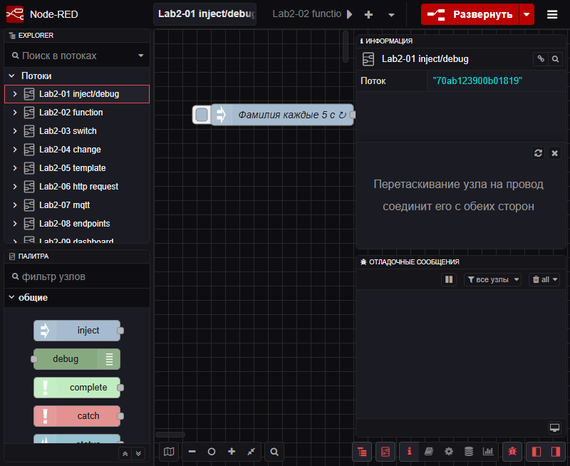

### Flow 02 — function

Inject подаёт число 5, function строит массив `1..5`, считает сумму циклом `for`
и возвращает объект `{input, sum, category, numbers, meta}`; в Debug виден `msg.payload`.

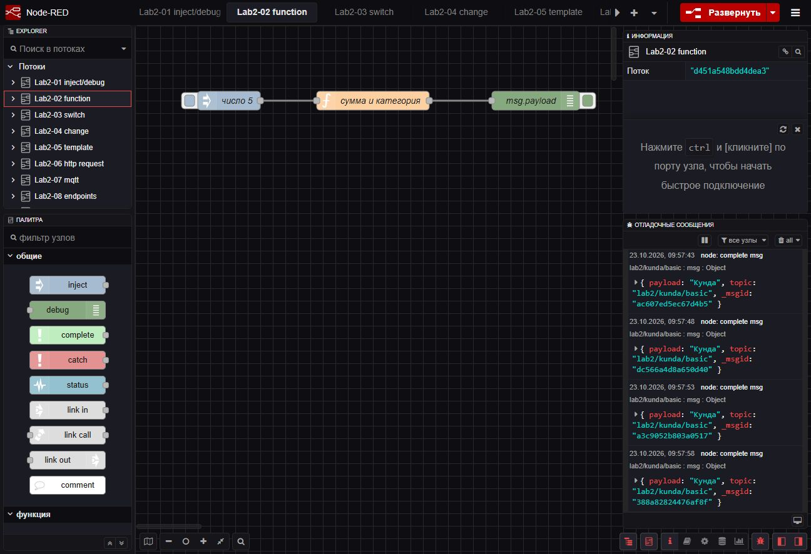

### Flow 03 — switch

Та же логика, но результат уходит в switch по `msg.payload.category`:
при `big` — в первый debug, всё остальное — в ветку `otherwise`.

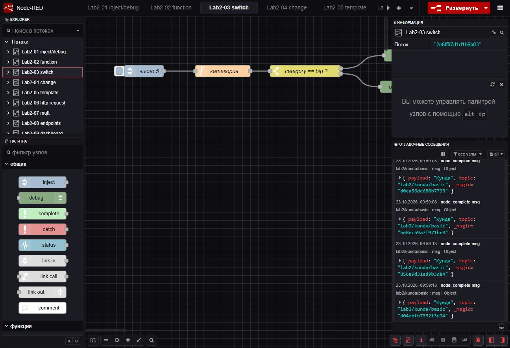

### Flow 04 — change

Нода change выставляет `msg.topic = "lab2/kunda/change"`, `msg.timestamp` (тип date)
и `msg.payload = "изменено через change"`; debug выводит сообщение целиком.

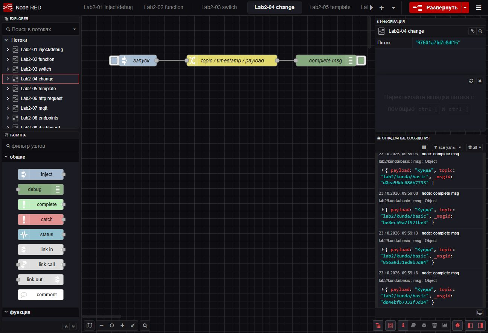

### Flow 05 — template

Inject передаёт объект `{"name":"Кунда","age":19,"group":"УИР-241"}`,
Mustache-шаблон формирует JSON с полями `student`, `age`, `group`, `greeting`.

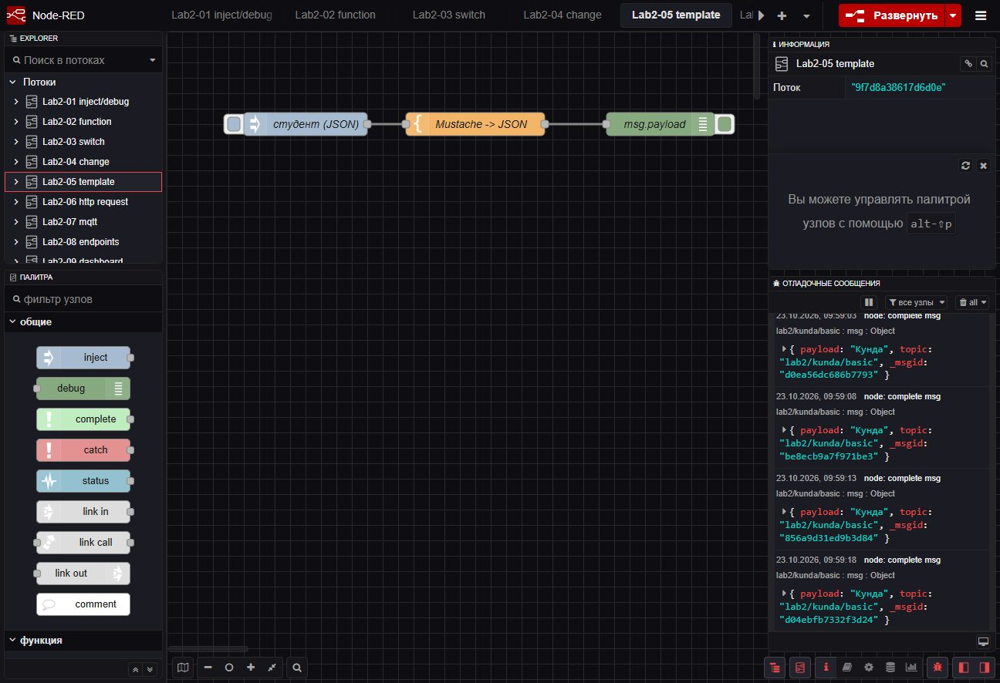

### Flow 06 — http request

Inject с payload типа date запускает GET-запрос к
`https://official-joke-api.appspot.com/random_joke`, ответ приходит разобранным объектом.

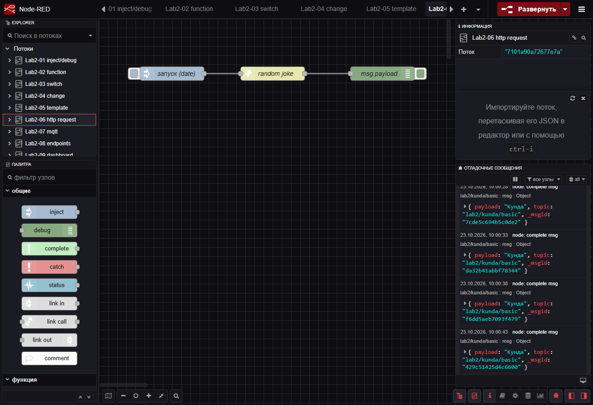

### Flow 07 — mqtt

Ветка публикации: inject раз в 5 секунд → function со случайным числом → mqtt out.
Ветка подписки: mqtt in на тот же топик → debug. Брокер — публичный HiveMQ.

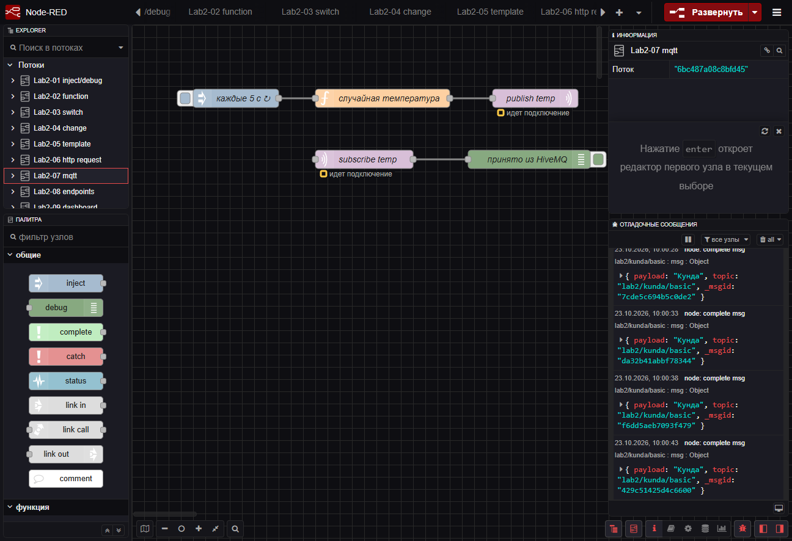

### Flow 08 — endpoints

Три независимые ветки `http in` → function → `http response`:
`/api/text`, `/api/info` и `/api/items/:id`.

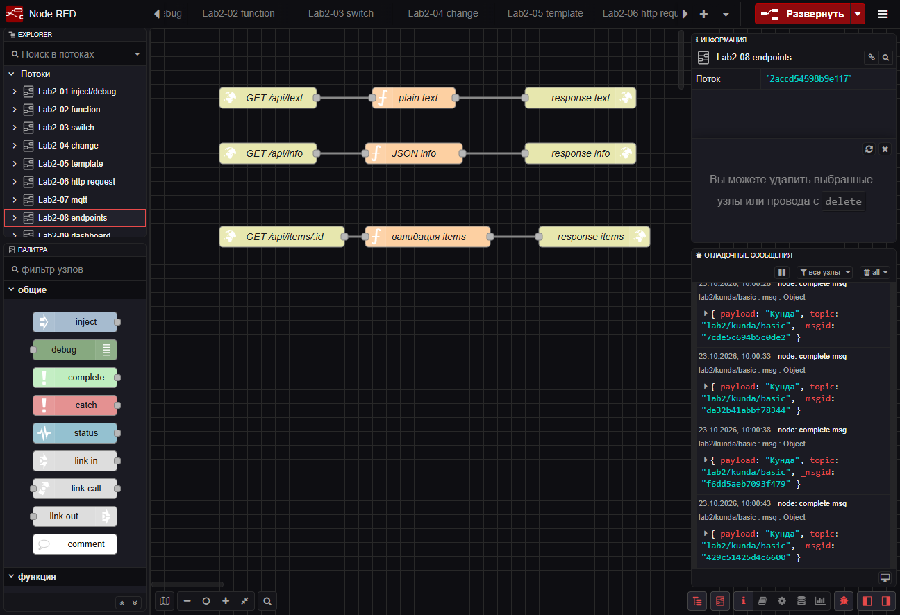

### Flow 10 — telegram

`telegram receiver` принимает сообщение, function разбирает команды, `telegram sender`
отправляет ответ. Бот — `@tvl_lab2_kunda_241_bot`, токен хранится только в локальной
конфигурации Node-RED.

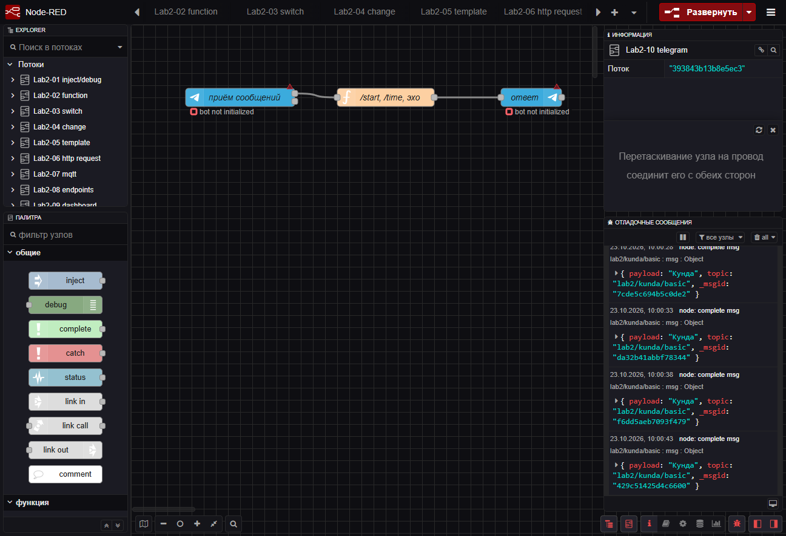

### Flow 11 — files

Верхняя ветка пишет данные в `C:/Users/kakah/lab2-data.json` (добавляет `ts`
и форматирует через `JSON.stringify(payload, null, 2)`), нижняя — читает файл и выводит
содержимое в debug.

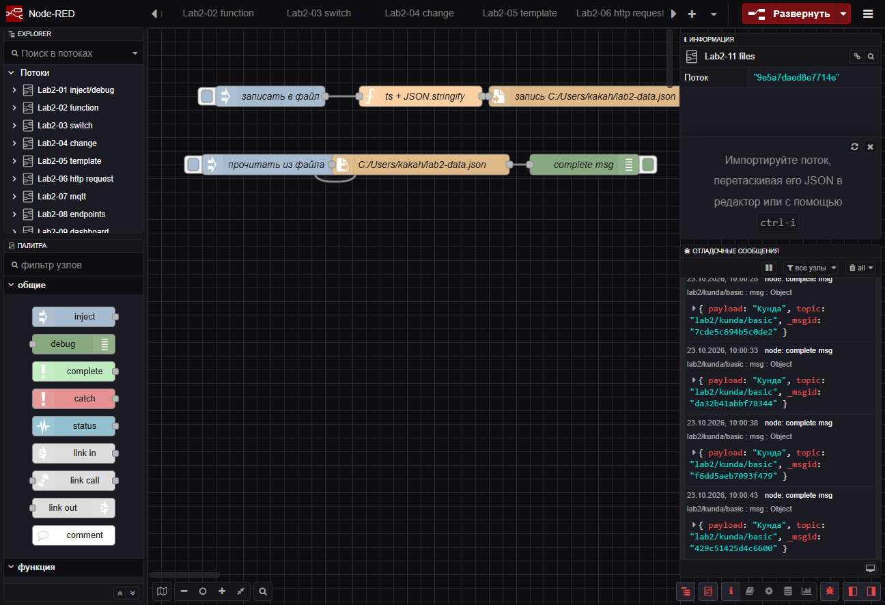

### Flow 12 — context

Кнопка «+1» увеличивает счётчик в flow context, кнопка «reset» удаляет переменную
через change.

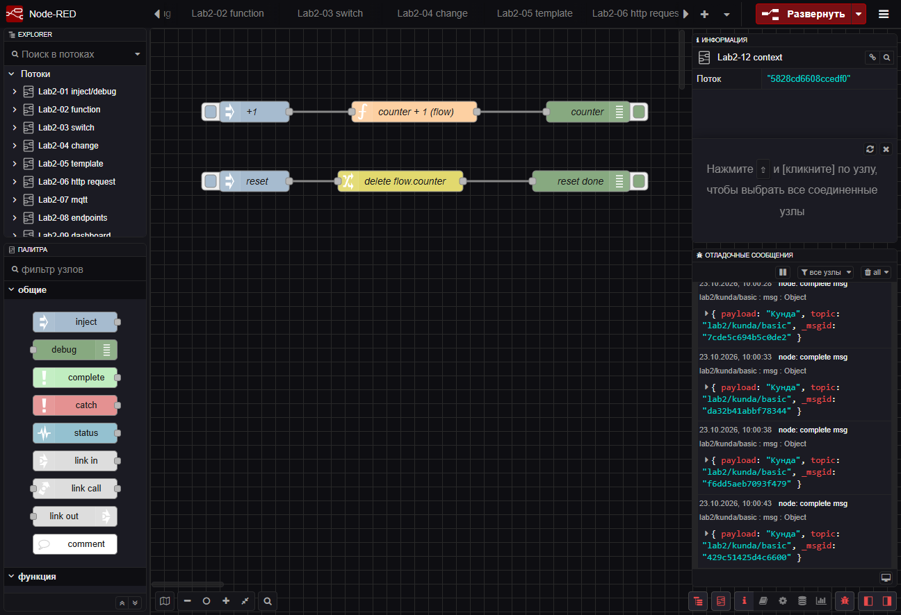

---

## 7. Проверка

### 7.1. REST-эндпоинты

| Запрос | Ожидание | Результат |
|--------|----------|-----------|
| `GET /api/text` | 200, `простой текст от Node-RED` | ✅ 200, `text/plain; charset=utf-8` |
| `GET /api/info` | 200, JSON app/author | ✅ 200, `{"app":"node-red-lab2","author":"kunda"}` |
| `GET /api/items/5` | 200, JSON | ✅ 200, `{"id":5,"name":"item-5","found":true}` |
| `GET /api/items/42?format=text` | 200, текст | ✅ 200, `item 42` |
| `GET /api/items/0` | 400 | ✅ 400, `{"error":"id должен быть положительным числом"}` |
| `GET /api/items/abc` | 400 | ✅ 400, `{"error":"id должен быть положительным числом"}` |
| `GET /api/items/999` | 404 | ✅ 404, `{"error":"item 999 не найден"}` |
| `GET /api/items/5?format=xml` | 400 | ✅ 400, `{"error":"недопустимый format"}` |

**`GET /api/text`**


**`GET /api/info`**


**`GET /api/items/5` → 200**

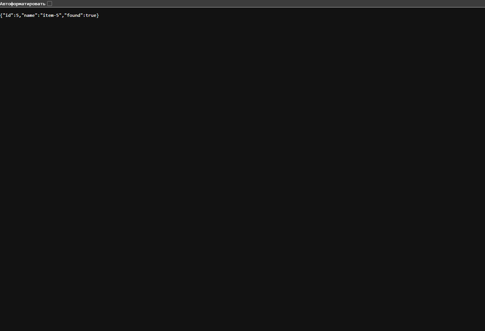

**`GET /api/items/0` → 400**


**`GET /api/items/999` → 404**

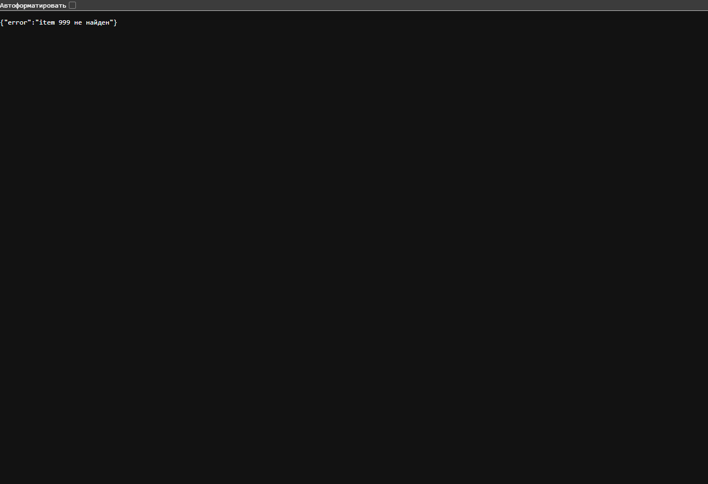

Текстом те же проверки выглядят так:

```text
$ curl -s http://localhost:1880/api/text
простой текст от Node-RED
$ curl -s http://localhost:1880/api/info
{"app":"node-red-lab2","author":"kunda"}
$ curl -s -w " [HTTP %{http_code}]" http://localhost:1880/api/items/0
{"error":"id должен быть положительным числом"} [HTTP 400]
$ curl -s -w " [HTTP %{http_code}]" http://localhost:1880/api/items/999
{"error":"item 999 не найден"} [HTTP 404]
$ curl -s -w " [HTTP %{http_code}]" "http://localhost:1880/api/items/5?format=xml"
{"error":"недопустимый format"} [HTTP 400]
```

### 7.2. Dashboard

Страница `http://localhost:1880/ui` открывается, вкладка **Lab2** содержит группу
**Датчики**: gauge «Температура» (диапазон 0…50, подпись °C) и линейный график
«История температуры, °C». Значения обновляются каждые 2 секунды в диапазоне 18…28 °C
с округлением до 0.1.

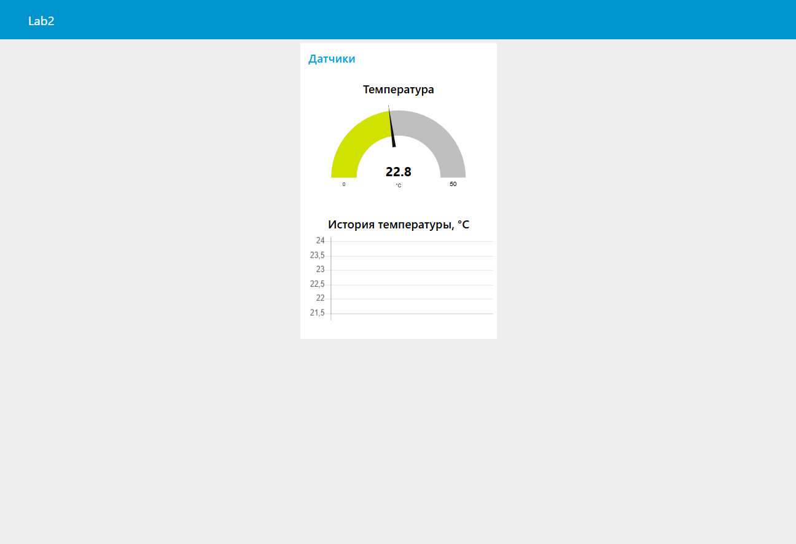

При первой сборке график показывал «нет данных»: у function-ноды один выход, а я подключил
`ui_gauge` и `ui_chart` как два разных выхода. После объединения проводов на одном выходе
и добавления `msg.topic` график начал строить линию.

### 7.3. Файлы

Inject «записать в файл» создаёт `C:\Users\kakah\lab2-data.json`. Содержимое (UTF-8):

```json
{
  "author": "kunda",
  "student": "Кунда",
  "group": "УИР-241",
  "lab": 2,
  "ts": "2026-10-23T06:41:10.516Z",
  "payload": { "author": "kunda", "lab": 2 }
}
```

Нода записи настроена с `overwriteFile = true`, поэтому файл перезаписывается, а не
дополняется. Ветка чтения (`file in`, utf8, одна строка) возвращает содержимое в debug.

### 7.4. Контекст

1. Нажал «+1» — счётчик стал `1`.
2. Подождал около 30 секунд, пока значение сбросится на диск.
3. Перезапустил Node-RED — счётчик остался `1`.
4. Нажал «+1» ещё раз — получил `2`.

Значит, flow context действительно переживает перезапуск.

### 7.5. MQTT — ограничение моей сети

Поток настроен на `broker.hivemq.com:1883`, топик `student/kunda/lab2/temp`.
В моей сети исходящие MQTT-соединения блокируются:

```text
[mqtt-broker:HiveMQ public] Connection failed to broker: mqtt://broker.hivemq.com:1883
Test-NetConnection broker.hivemq.com -Port 1883 -> False
Test-NetConnection test.mosquitto.org -Port 1883 -> False
wss://broker.hivemq.com:8884/mqtt -> connack timeout
HTTPS (443) -> True
```

HTTPS работает (поток 06 получает ответ от API), блокировка касается именно MQTT.
Конфигурация потока при этом корректная: ошибок импорта и настройки нет, при запуске
в сети без ограничений обмен сообщениями заработает без изменений.

### 7.6. Telegram

Бот создан через `@BotFather`, username — `@tvl_lab2_kunda_241_bot`, токен вставлен
в ноду `telegram bot` и хранится только в локальной конфигурации Node-RED
(в репозиторий и в `flows/*.json` он не попадает). После деплоя бот инициализируется
без ошибок: в логе нет сообщений `Token ... is not set`, метод `getMe` подтверждает
username, режим — polling (webhook не задан).

Проверка команд:

```
/start → Привет! Я бот lab2.
/time  → Текущее время: <дата и время>
любой текст → Эхо: <текст>
```

---

## 8. Выводы

Я научился устанавливать и настраивать Node-RED через npm без Docker, подключать
сторонние пакеты (`node-red-dashboard`, `node-red-contrib-telegrambot`) и включать
персистентный контекст. В ходе работы я собрал 12 потоков: от простых inject/debug
до REST-сервиса, MQTT-обмена, dashboard и Telegram-бота. На практике убедился, что
HTTP-эндпоинты возвращают корректные коды 200/400/404 и заголовки `Content-Type`,
файл пишется в UTF-8, а счётчик в flow context сохраняется между перезапусками.
Отдельным уроком стали ограничения окружения: блокировка исходящего MQTT-порта
и необходимость держать секреты (Telegram-токен) вне репозитория.
Визуальное программирование в Node-RED ускоряет сборку интеграций, но требует
внимания к версиям нод и к тому, как соединены выходы (ошибка с графиком как раз
об этом).
