# Лабораторная работа №5 — Чат-боты

**Студент:** Кунда  
**Группа:** СДП-УИР-241  
**Трек:** C — TypeBot, self-hosted версия  
**Дата:** 25.11.2026

## 1. Что делал

Я выбрал трек C и развернул у себя TypeBot в self-hosted режиме: builder и viewer,
PostgreSQL 16 и локальную SMTP-ловушку для входа по коду. Официальный
`docker-compose.yml` TypeBot я сохранил в `lab5/selfhosted/docker-compose.yml`, чтобы
была эталонная конфигурация. На этой машине Docker/WSL2 недоступны без прав
администратора, поэтому я пошел по официальному пути Manual deployment: исходники
TypeBot 3.18.0, Node.js 24, bun и встроенный PostgreSQL. В итоге у меня получился
рабочий инстанс с настоящим flow, опубликованным ботом и результатами диалогов.
Все скриншоты ниже сделаны именно из этого запущенного инстанса.

## 2. Ссылки на мой бот и файлы

- Builder: <http://localhost:8080>
- Публичная ссылка на бота: <http://127.0.0.1:8081/kunda-lab5-sdp-uir-241>
- Редактор flow: <http://localhost:8080/typebots/cmwv249ca0003vgf7b74kla2e/edit>
- Экспорт-flow: [`../exports/flow-01-Kunda-typebot.json`](../exports/flow-01-Kunda-typebot.json)
- Сервер, куда бот отправляет событие: <http://localhost:7788/typebot-event>

## 3. Инструменты

Для развертывания и проверки я использовал Node.js, bun, PostgreSQL, Playwright
и локальный SMTP-сервер. Небольшие скрипты в `lab5/scripts/` помогли мне
автоматизировать регистрацию, создание workspace и бота, сборку flow, прогон
диалога и съемку скриншотов, чтобы все шаги были воспроизводимыми.

## 4. Освоенные блоки

| Блок | Где использовал |
|------|-----------------|
| Start event | Отправная точка диалога |
| Text bubble | Приветствие на русском, ответы веток, fallback |
| Text input + Variable | Сбор `user_name` и `user_group` |
| Condition | Проверка `user_group == СДП-УИР-241`, ветки «свой»/«чужой» и else |
| HTTP Request (Webhook) | POST на локальный echo-сервер `http://localhost:7788/typebot-event` |
| Buttons (choice input) | «Задать вопрос» / «Связаться с админом» |
| Fallback (invalidReply event + invalidMessage) | Ответ на неизвестный ввод |
| Theme / Branding | Фиолетовая палитра #5B4BDB, SVG-логотип, заголовок страницы |

Сначала я собрал приветствие и два поля ввода, затем добавил переменные
`user_name` и `user_group`. После этого подключил Condition: если группа совпадает
с `СДП-УИР-241`, диалог идет в ветку «свой», где бот отправляет POST-запрос на
локальный webhook и предлагает две кнопки. Иначе открывается ветка «чужой».
Для неизвестного ввода я настроил отдельное сообщение fallback.

## 5. Скриншоты

Регистрация и создание бота:

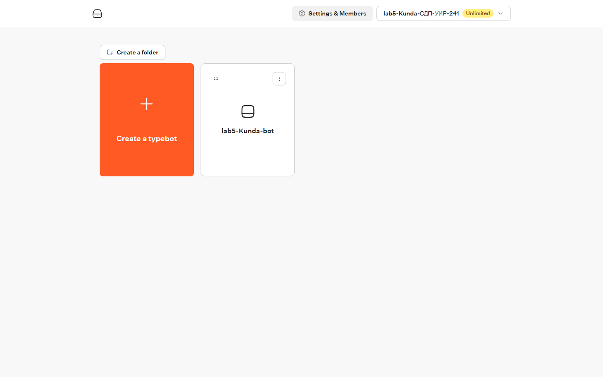
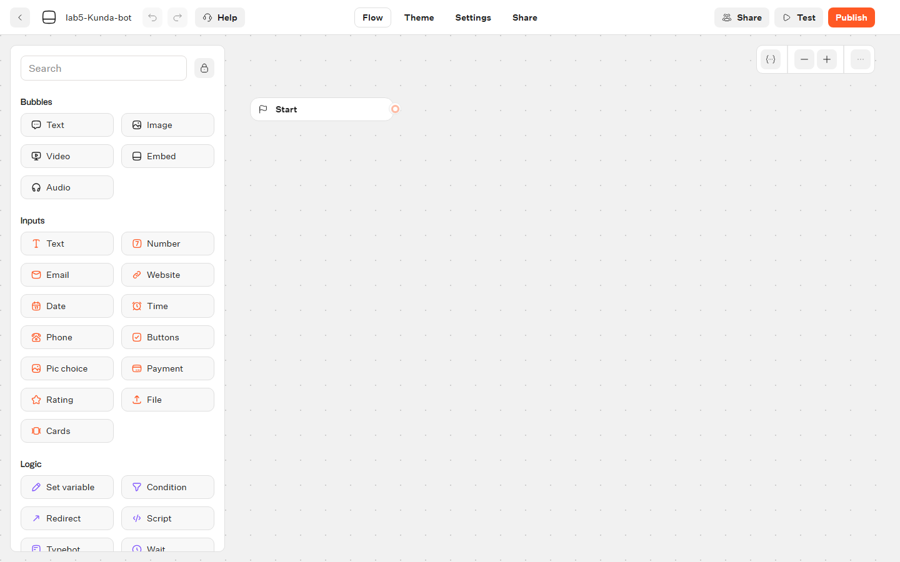

Диалог и обе ветки условия:

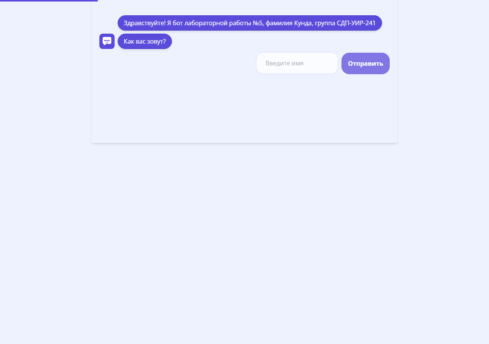
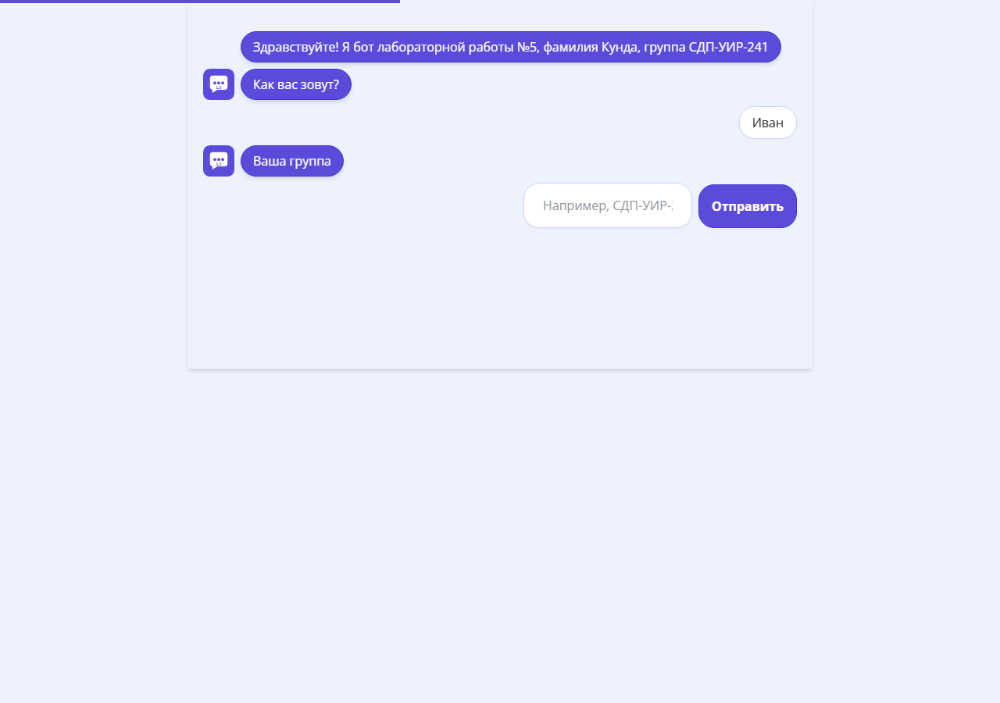
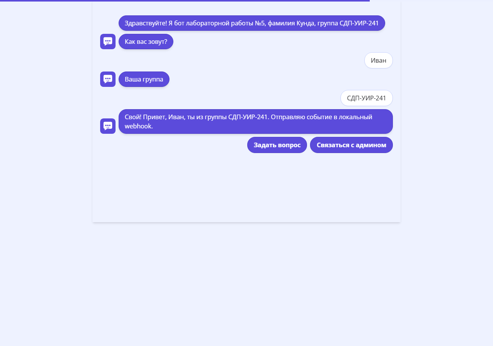
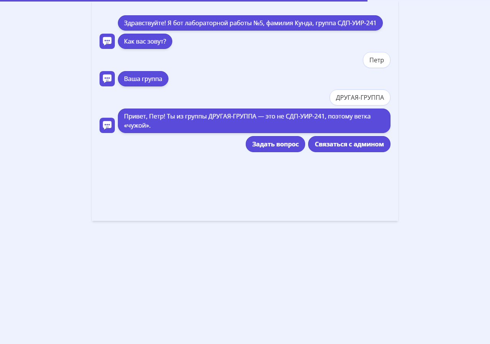
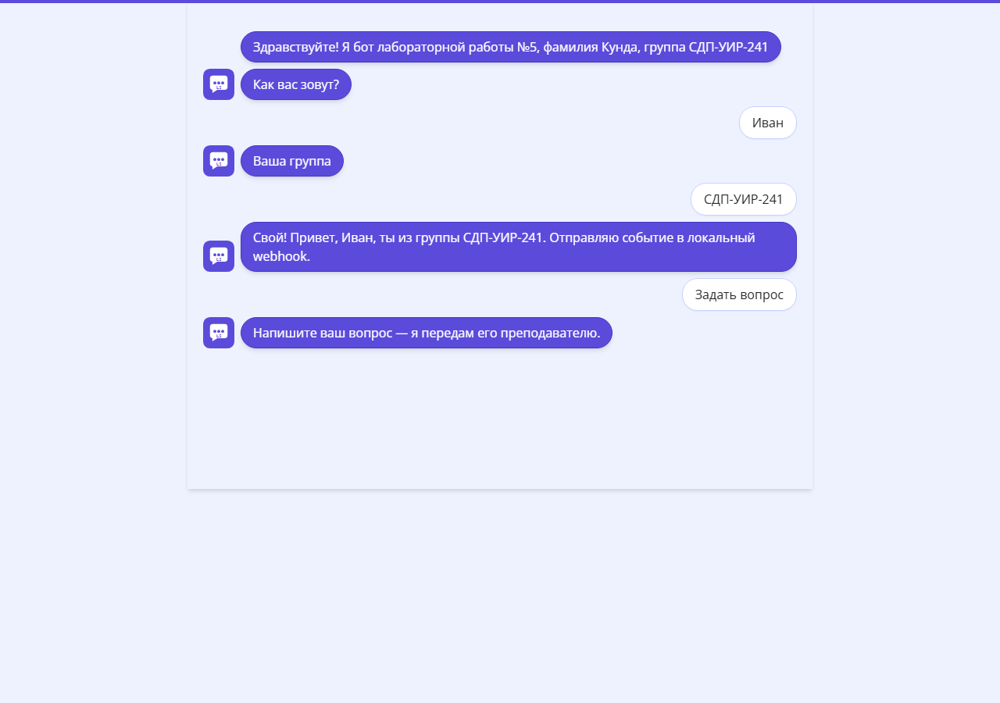

Настройки в редакторе и админка:

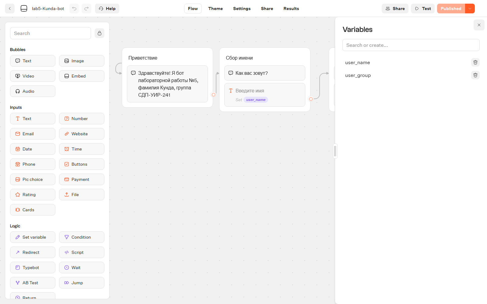
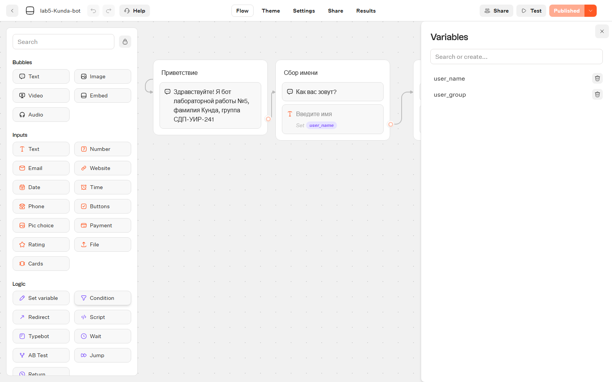
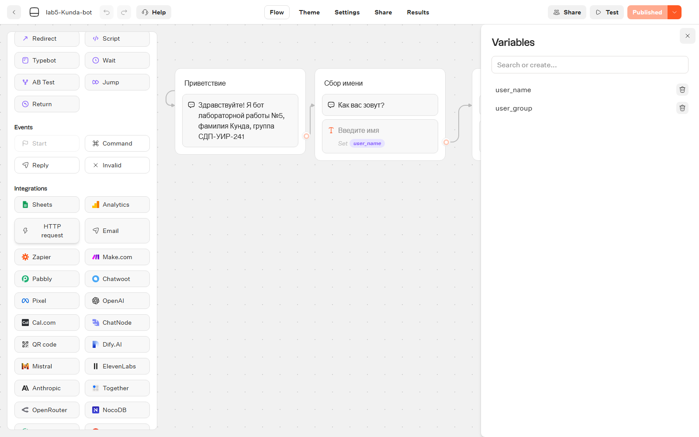
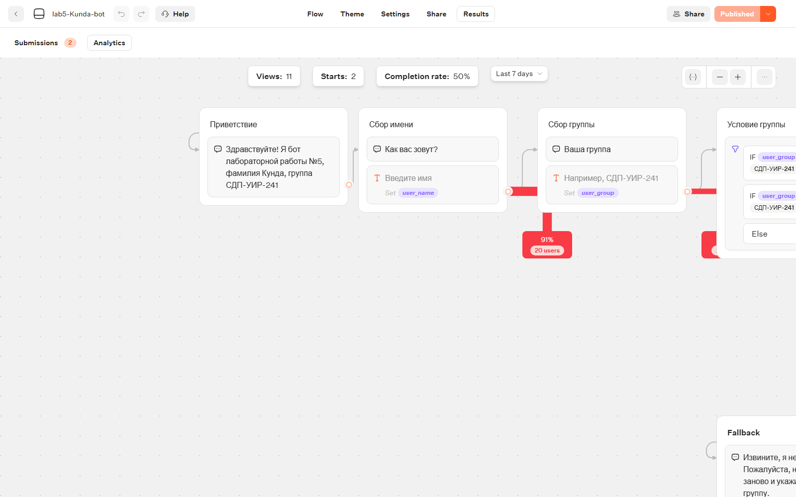

## 6. Выводы

В ходе работы я развернул работающий self-hosted TypeBot и убедился, что визуальная
сборка диалога позволяет быстро соединять ввод, переменные и условия без
программирования логики вручную. Я собрал ветвление по группе, отправил событие
во внешний echo-сервер и проверил обе ветки в опубликованном боте. Отдельно
проверил, что HTTP Request действительно доходит до локального сервера: запрос
виден в `webhook-log.txt`.

Главная сложность была в том, что на машине нет Docker, поэтому пришлось
воспользоваться официальным Manual deployment. Это оказалось рабочим вариантом:
я получил тот же результат — builder, viewer, реальный flow и лог запросов.
Дальше я бы добавил сохранение вопросов в results и авторизацию пользователей.
